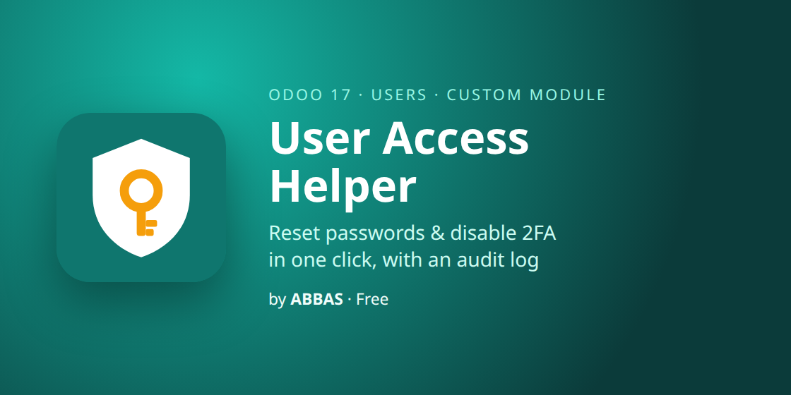

# User Access Helper — Odoo 17

Fix the most common Odoo support tickets — "I forgot my password" and "I lost my 2FA phone" —
straight from **Settings › Users**, for one user or many.

## Features
- **Bulk password reset**: set a new password for all selected users at once (8+ characters, typed twice)
- **Disable 2FA**: turn off two-factor authentication and revoke trusted devices
- **Odoo's own security check**: the admin confirms their password before any change
- **Audit log**: who did it, for whom and when (Settings › Users & Companies › User Access Log)
- **Admins only**, covered by automated tests; depends only on `base` and `auth_totp`

## Install
Copy `user_access_helper` into your addons path, update the Apps list and install **User Access Helper**.

## Author
**ABBAS** — custom Odoo development (Odoo 17 & 19). Support: abbasodolution@gmail.com

License: LGPL-3
